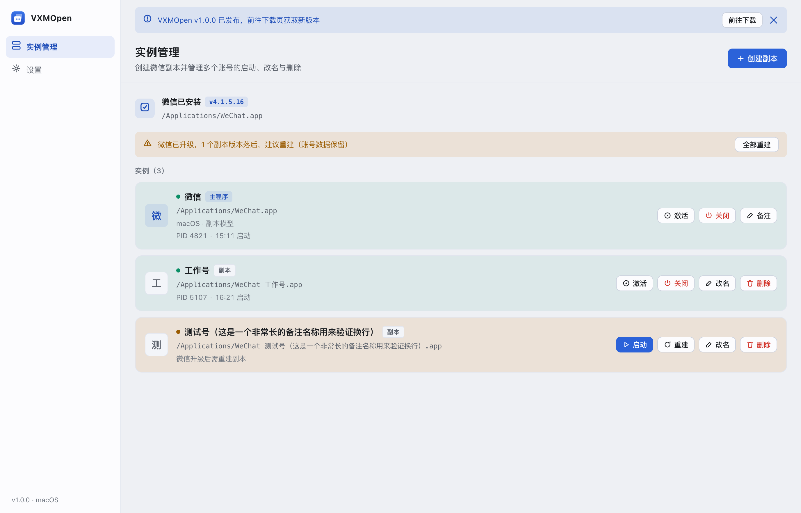
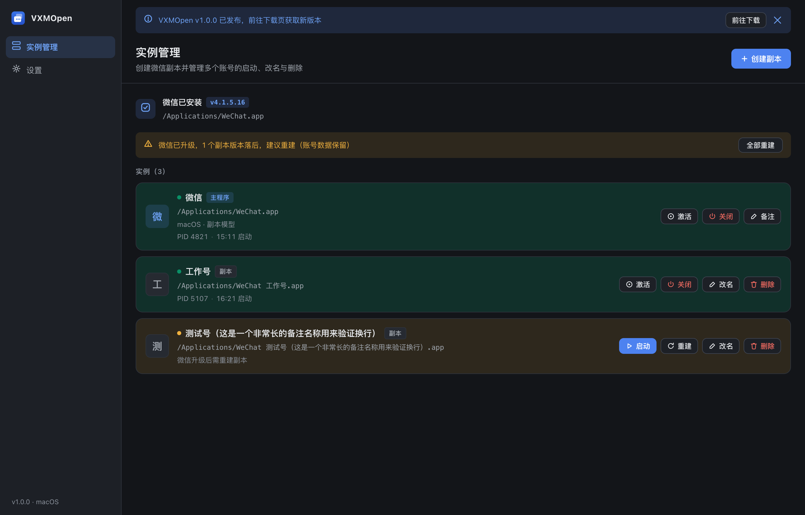
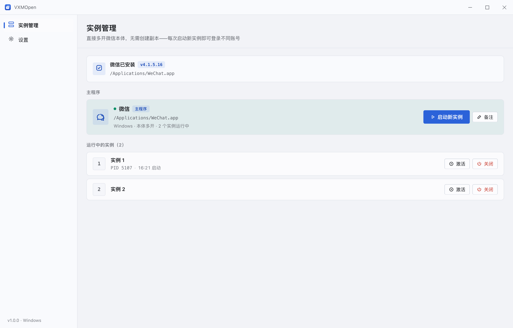
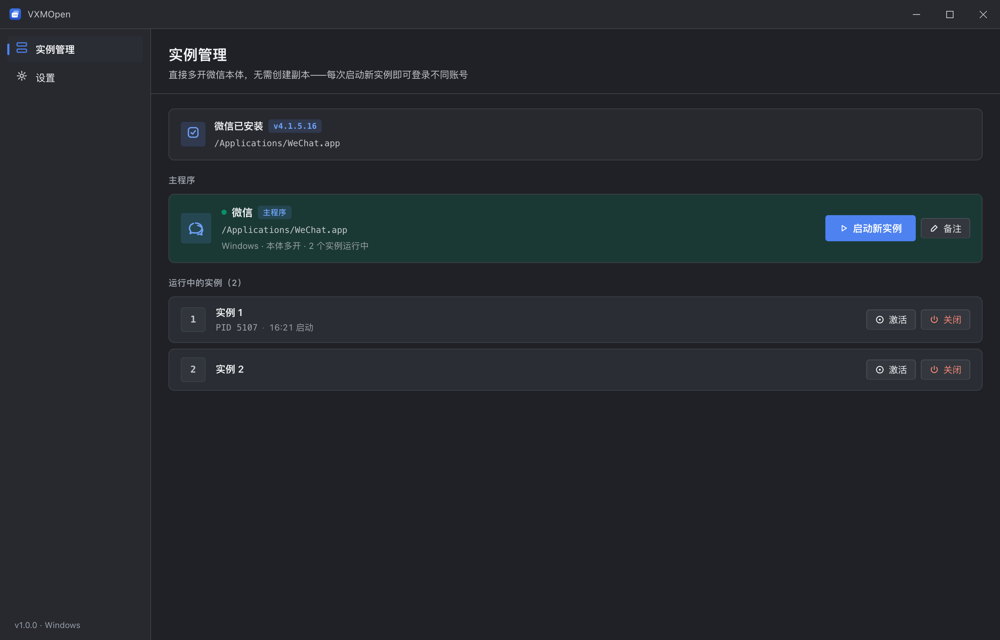

# vx-m-open

<p align="center">
  
  
  
  
  
  
  
  
</p>

<p align="center">
  <strong>跨平台微信多开与实例管理工具</strong><br>
  一个应用管理多个微信账号 —— macOS 走独立副本，Windows 走本体多开，不修改微信本体
</p>
<p align="center">
  <sub><b>English:</b> Cross-platform WeChat multi-instance &amp; multi-account manager — run multiple WeChat accounts side by side on macOS &amp; Windows, without modifying WeChat itself.</sub>
</p>

---

## ✨ 功能特点

- 🔍 **环境检测** — 自动识别微信安装路径与版本（macOS 扫描应用目录，Windows 读注册表）
- 🧬 **一键副本（macOS）** — APFS 克隆 + 改 Bundle ID + 重签名，约 10 秒生成独立副本，自定义名字同步显示在 Finder / 启动台 / Dock
- 🪟 **本体多开（Windows）** — 挂起启动 + 关闭单实例互斥体，每点一次「启动新实例」多开一个，不产生任何副本文件
- 🔄 **版本同步** — 微信升级后自动提示，一键重建全部落后副本（账号数据完整保留，无需重新登录）
- 🖥️ **实例面板** — 实时显示运行状态、PID、启动时间；启动 / 激活 / 关闭一处完成
- 🏷️ **备注与改名** — 副本改名同步系统显示名，主程序支持工具内备注名
- 🌐 **中英双语** — 界面跟随系统语言，可在设置中手动切换
- 🌗 **明暗主题** — 亮色 / 暗色 / 跟随系统
- 🔔 **新版本提醒** — 启动时自动检查 GitHub Release，有新版提示前往下载

## 📸 界面预览

<p align="center">
  &nbsp;&nbsp;&nbsp;&nbsp;
</p>
<p align="center">
  <sub>macOS 副本模型：系统设置式平面语言 + 实例卡片（亮 / 暗）</sub>
</p>
<p align="center">
  &nbsp;&nbsp;&nbsp;&nbsp;
</p>
<p align="center">
  <sub>Windows 本体多开：Fluent 自绘标题栏 + 主程序卡 + 运行实例列表（亮 / 暗）</sub>
</p>

## 🧩 多开原理

| 平台 | 原理 | 是否修改微信本体 |
| --- | --- | --- |
| macOS | 微信 4.x 的单实例限制是沙盒容器内的 `app_data/lock/lock.ini` 文件锁，容器路径由 Bundle ID 决定。工具克隆应用并修改 Bundle ID + 重签名，副本落入独立容器 → 独立锁 → 与主程序共存 | 否（仅副本） |
| Windows | 微信以命名互斥体限制单开。启动时挂起进程，轮询定位单实例互斥体句柄并关闭后恢复执行，微信将认为自己第一个启动，从而多开 | 否 |

- macOS 方案已在微信 4.1.15 实测验证
- Windows 方案支持微信 3.x（`WeChat.exe`）与 4.x（`Weixin.exe`），自动识别注册表安装路径

## 🚀 快速开始

### 系统要求

| 要求 | 说明 |
|------|------|
| macOS | 11.0 (Big Sur) 或更高，Apple Silicon / Intel 均可（通用二进制） |
| Windows | Windows 10 / 11，x64 |
| 微信 | macOS 4.x；Windows 3.x / 4.x |

### 安装

#### 方式一：下载安装包（推荐）

1. 前往 [Releases](https://github.com/xiaoRui278/vx-m-open/releases) 下载对应平台安装包：
   - macOS：`vx-m-open_*_universal.dmg`（Intel 与 Apple Silicon 通用）
   - Windows：`vx-m-open_*_x64-setup.exe`（NSIS）或 `*.msi`
2. macOS 将应用拖入「应用程序」；Windows 按向导安装

> 💡 也可以在 [Actions](https://github.com/xiaoRui278/vx-m-open/actions) 页面每次构建的 Artifacts 中下载最新构建产物。

> ⚠️ **macOS 首次打开**：应用使用 ad-hoc 签名、未经公证，首次打开请**右键 → 打开**；若仍被拦截，在终端执行 `xattr -cr /Applications/vx-m-open.app` 后再打开。

#### 方式二：从源码编译

```bash
git clone https://github.com/xiaoRui278/vx-m-open.git
cd vx-m-open
pnpm install
pnpm tauri dev    # 开发模式（热重载）
pnpm tauri build  # 打包 dmg / msi
```

> 🚢 **发版**：普通提交不触发构建；发新版只需改版本号后 `git tag vX.Y.Z && git push origin vX.Y.Z`，CI 自动构建双平台并创建正式 Release。

## 📖 使用方法

### macOS（副本模型）

1. 打开应用，确认顶部环境检测条显示微信已安装
2. 点击右上角 **创建副本**，输入名字（如「工作号」），等待分步进度（克隆 → 改 Bundle ID → 重签名）完成
3. 在实例卡片上 **启动** 副本，即可用另一个账号登录微信
4. 微信升级后会出现黄色提示条，点击 **全部重建** 即可批量更新副本，账号数据保留

### Windows（本体多开）

1. 打开应用，确认微信主程序已识别
2. 点击 **启动新实例**，每点一次多开一个微信窗口，分别登录不同账号
3. 在「运行中的实例」列表中可 **激活** 或 **关闭** 指定实例

## ⚙️ 设置

| 设置项 | 说明 |
|--------|------|
| 语言 | 中文 / English，默认跟随系统 |
| 主题 | 亮色 / 暗色 / 跟随系统 |
| 检查更新 | 手动检查 GitHub 最新 Release |
| GitHub | 项目主页直达入口 |

## 🏗️ 技术架构

```
src-tauri/src/              # Rust 后端（Tauri 2）
├── commands.rs             # Tauri Command 层（全部 async + spawn_blocking）
├── config.rs               # 持久化配置（主程序备注名）
├── platform/
│   ├── mod.rs              # 平台抽象（LaunchTarget / provider 分发）
│   ├── macos.rs            # APFS 克隆 / Bundle ID / codesign 重签名
│   ├── windows.rs          # 挂起启动 / 句柄枚举 / 互斥体关闭
│   └── unsupported.rs      # 其他平台占位
src/                        # 前端（Vue 3 + TypeScript）
├── views/                  # 实例管理 / 设置
├── stores/appStore.ts      # Pinia 状态（轮询 + 长操作封装）
├── i18n.ts                 # 中英双语
└── style.css               # 双平台设计令牌（明暗主题 × mac/windows）
```

### 技术栈

| 技术 | 用途 |
|------|------|
| Tauri 2 / Rust | 桌面壳与系统能力，全异步后端不阻塞 UI |
| Vue 3 / Pinia | 界面与状态管理 |
| APFS clonefile + codesign | macOS 秒级副本创建与 ad-hoc 重签名 |
| NT API（NtQuerySystemInformation / NtQueryObject） | Windows 句柄枚举与互斥体定位 |

## 🗺️ 路线图

- [x] M1 项目脚手架 + macOS 检测 / 枚举 / 启动 / 关闭
- [x] M2 macOS 副本管理（创建 / 改名 / 删除 / 自定义命名 / 主程序备注）
- [x] M3 版本同步检测 + 一键重建；GitHub Actions 打包
- [x] M4 Windows 互斥体多开模块
- [x] M4.5 UI/UX 重构：双平台界面 + 中英双语 + 明暗主题 + 新版本提醒
- [x] M5 v1.0.0 正式发布（tag 触发自动 Release）
- [ ] M6 Homebrew / Scoop 分发、应用内自动更新

## 📝 更新日志

### v1.0.0 (2026-10-21)
- 🎉 首个正式版本
- 🎨 全新界面：macOS / Windows Fluent 双平台设计，亮暗双主题
- 🌐 中英双语，可设置首选语言
- ✨ 创建副本分步进度弹框（克隆 → 改 Bundle ID → 重签名）
- ✨ 「全部重建」批量重建落后副本，带进度展示
- ✨ 设置页：语言 / 主题 / GitHub / 检查更新
- ☕ 设置页与 README 新增「支持作者」捐赠入口（微信 / 支付宝收款码）
- 🔔 启动时检查新版本，顶部提示前往下载
- ✅ macOS：副本创建 / 改名 / 删除、启动 / 激活 / 关闭、版本同步重建
- ✅ Windows：互斥体多开、实例列表管理
- ✅ GitHub Actions：tag 触发自动构建并发布 Release

### v0.1.0
- ✅ macOS：环境检测、副本创建 / 改名 / 删除、启动 / 激活 / 关闭、版本同步重建
- ✅ Windows：互斥体多开、实例列表管理（待实机验证）
- ✅ GitHub Actions 持续构建（macOS universal + Windows x64）

## 边界声明

本工具只做启动层处理，刻意不做以下功能：自动化操作、群控、批量营销、防撤回、消息修改。

> ⚠️ 本项目为非官方第三方工具，与腾讯官方无关。仅供个人多账号管理使用，请遵守《微信软件许可及服务协议》，使用风险自负。

## ☕ 支持作者

如果这个工具帮到了你，欢迎请作者喝杯咖啡～

<p align="center">
  &nbsp;&nbsp;&nbsp;&nbsp;&nbsp;&nbsp;
</p>
<p align="center">
  <sub>微信支付 · 支付宝 &nbsp;|&nbsp; Enjoying vx-m-open? Buy the author a coffee ☕</sub>
</p>

## 📄 许可证

MIT License © [xiaoRui278](https://github.com/xiaoRui278)

---

<p align="center">
  <sub>Made with ❤️ and AI (Vibe Coding)</sub>
</p>
