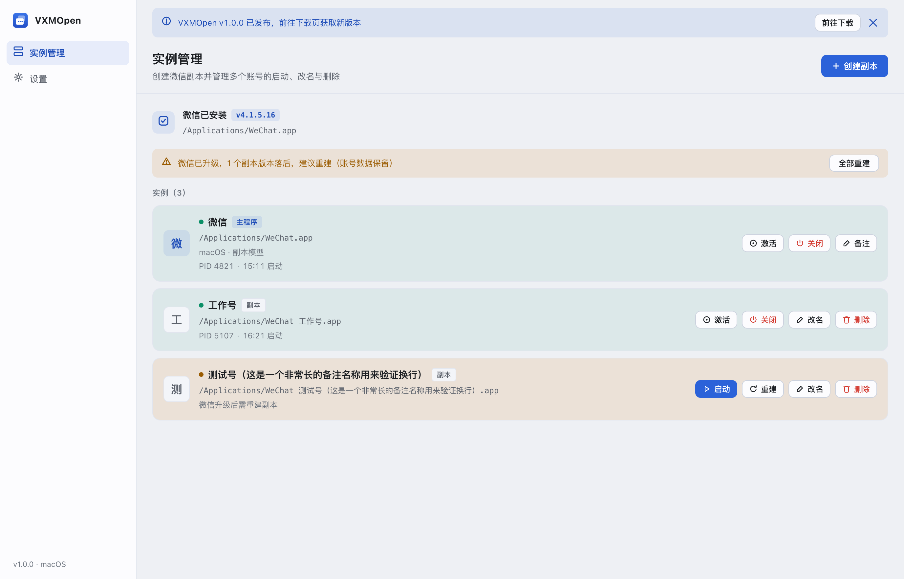
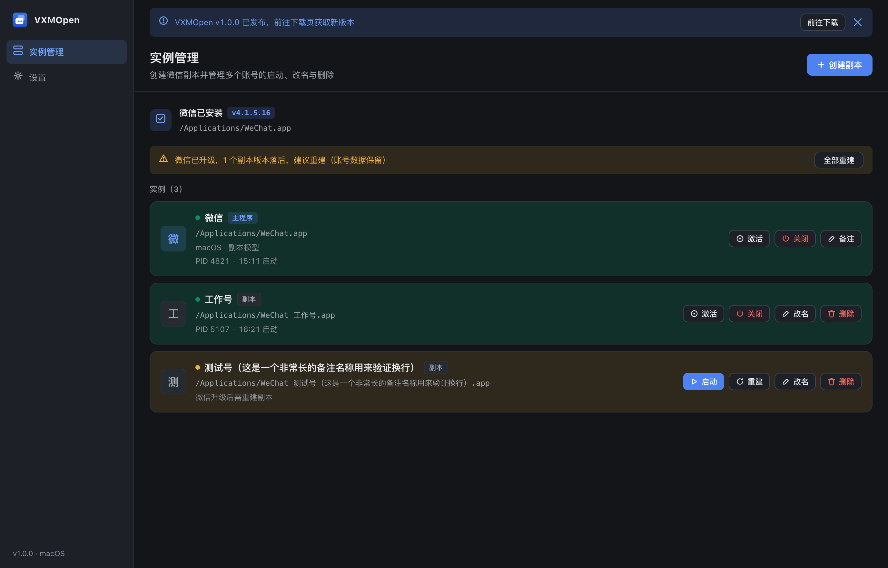
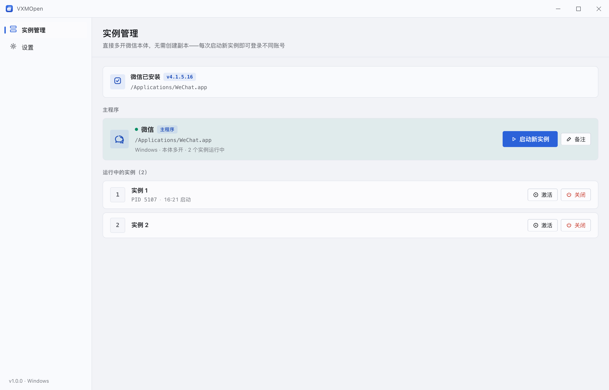
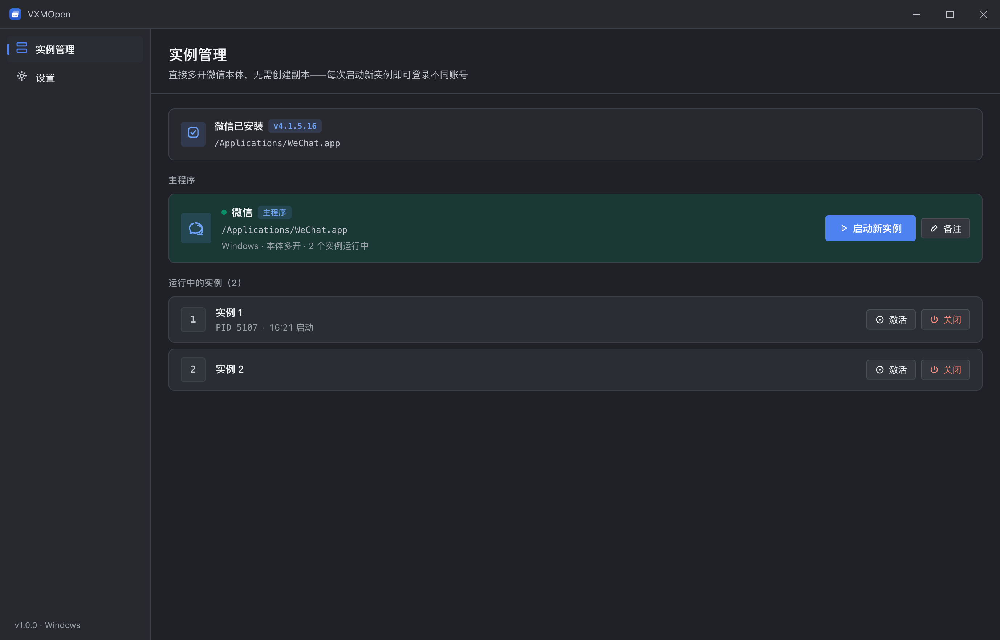

# vx-m-open

<p align="center">
  
  
  
  
  
  
  
  
</p>

<p align="center">
  <strong>跨平台微信多开与实例管理工具</strong><br>
  一个应用管理多个微信账号 —— macOS 走独立副本，Windows 走本体多开，不修改微信本体
</p>
<p align="center">
  <sub><b>English:</b> Cross-platform WeChat multi-instance &amp; multi-account manager — run multiple WeChat accounts side by side on macOS &amp; Windows, without modifying WeChat itself.</sub>
</p>

<p align="center">
  <b>🌐 官网 / Website：<a href="https://vxmo.cting.vip/">vxmo.cting.vip</a></b>
</p>

---

## ✨ 功能特点

- 🔍 **环境检测** — 自动识别微信安装路径与版本（macOS 扫描应用目录，Windows 读注册表）
- 🧬 **一键副本（macOS）** — APFS 克隆 + 改 Bundle ID + 重签名，约 10 秒生成独立副本，自定义名字同步显示在 Finder / 启动台 / Dock
- 🪟 **本体多开（Windows）** — 挂起启动 + 关闭单实例互斥体，每点一次「启动新实例」多开一个，不产生任何副本文件
- 🔄 **版本同步** — 微信升级后自动提示，一键重建全部落后副本（账号数据完整保留，无需重新登录）
- 🖥️ **实例面板** — 实时显示运行状态、PID、启动时间；启动 / 激活 / 关闭一处完成
- 🏷️ **备注与改名** — 副本改名同步系统显示名，主程序支持工具内备注名
- 🌐 **中英双语** — 界面跟随系统语言，可在设置中手动切换
- 🌗 **明暗主题** — 亮色 / 暗色 / 跟随系统
- 🚀 **自动更新** — 启动时检查新版本，一键下载安装并重启（官网通道优先，GitHub 兜底）；通道不可用时自动降级为官网下载
- 🪟 **Windows 中文安装器** — 安装 / 卸载界面自动跟随系统语言（中 / 英）

## 🧾 产品信息

- **名称**：vx-m-open —— 跨平台微信多开管理器（微信多开 / 微信双开 / 微信分身工具）
- **支持平台**：macOS 11+（Apple Silicon / Intel）、Windows 10 / 11（x64）
- **支持微信版本**：macOS 微信 4.x；Windows 微信 3.x（`WeChat.exe`）/ 4.x（`Weixin.exe`）
- **技术栈**：Tauri 2 + Rust + Vue 3 + Pinia + TypeScript
- **核心特点**：不修改微信本体、无副本残留（Windows）、副本秒级创建（macOS）、微信升级后一键重建副本、账号数据独立保留
- **不支持**：自动化操作、群控、批量营销、防撤回、消息修改
- **官网**：<https://vxmo.cting.vip/>
- **许可证**：MIT

## 📸 界面预览

<p align="center">
  &nbsp;&nbsp;&nbsp;&nbsp;
</p>
<p align="center">
  <sub>macOS 副本模型：系统设置式平面语言 + 实例卡片（亮 / 暗）</sub>
</p>
<p align="center">
  &nbsp;&nbsp;&nbsp;&nbsp;
</p>
<p align="center">
  <sub>Windows 本体多开：Fluent 自绘标题栏 + 主程序卡 + 运行实例列表（亮 / 暗）</sub>
</p>

## 🧩 多开原理

| 平台 | 原理 | 是否修改微信本体 |
| --- | --- | --- |
| macOS | 微信 4.x 的单实例限制是沙盒容器内的 `app_data/lock/lock.ini` 文件锁，容器路径由 Bundle ID 决定。工具克隆应用并修改 Bundle ID + 重签名，副本落入独立容器 → 独立锁 → 与主程序共存 | 否（仅副本） |
| Windows | 微信以命名互斥体限制单开。启动时挂起进程，轮询定位单实例互斥体句柄并关闭后恢复执行，微信将认为自己第一个启动，从而多开 | 否 |

- macOS 方案已在微信 4.2.0.12 实测验证
- Windows 方案支持微信 3.x（`WeChat.exe`）与 4.x（`Weixin.exe`），自动识别注册表安装路径

## 🚀 快速开始

### 系统要求

| 要求 | 说明 |
|------|------|
| macOS | 11.0 (Big Sur) 或更高，Apple Silicon / Intel 均可（通用二进制） |
| Windows | Windows 10 / 11，x64 |
| 微信 | macOS 4.x；Windows 3.x / 4.x |

### 安装

#### 方式一：下载安装包（推荐）

最简单的方式是打开官网 [vxmo.cting.vip](https://vxmo.cting.vip/)，页面会自动识别你的平台给出对应安装包。

也可以前往 [Releases](https://github.com/xiaoRui278/vx-m-open/releases) 手动选择：
   - macOS：`vx-m-open_*_universal.dmg`（Intel 与 Apple Silicon 通用）
   - Windows：`vx-m-open_*_x64-setup.exe`（NSIS）或 `*.msi`

安装：macOS 将应用拖入「应用程序」；Windows 按向导安装。

> 💡 也可以在 [Actions](https://github.com/xiaoRui278/vx-m-open/actions) 页面每次构建的 Artifacts 中下载最新构建产物。

> ⚠️ **macOS 首次打开**：应用使用 ad-hoc 签名、未经公证，首次打开请**右键 → 打开**；若仍被拦截，在终端执行 `xattr -cr /Applications/vx-m-open.app` 后再打开。

#### 方式二：从源码编译

```bash
git clone https://github.com/xiaoRui278/vx-m-open.git
cd vx-m-open
pnpm install
pnpm tauri dev    # 开发模式（热重载）
pnpm tauri build  # 打包 dmg / msi
```

> 🚢 **发版**：普通提交不触发构建；发新版只需改版本号后 `git tag vX.Y.Z && git push origin vX.Y.Z`，CI 自动构建双平台并创建正式 Release。

## 📖 使用方法

### macOS（副本模型）

1. 打开应用，确认顶部环境检测条显示微信已安装
2. 点击右上角 **创建副本**，输入名字（如「工作号」），等待分步进度（克隆 → 改 Bundle ID → 重签名）完成
3. 在实例卡片上 **启动** 副本，即可用另一个账号登录微信
4. 微信升级后会出现黄色提示条，点击 **全部重建** 即可批量更新副本，账号数据保留

### Windows（本体多开）

1. 打开应用，确认微信主程序已识别
2. 点击 **启动新实例**，每点一次多开一个微信窗口，分别登录不同账号
3. 在「运行中的实例」列表中可 **激活** 或 **关闭** 指定实例

> 💡 微信 4.1.7+ 同一设备同时登录上限为 4 个账号，第 5 个扫码时会提示「暂无法在当前设备登录更多账号」，这是微信官方限制（见 [FAQ](#-常见问题faq)）。

## ⚙️ 设置

| 设置项 | 说明 |
|--------|------|
| 语言 | 中文 / English，默认跟随系统 |
| 主题 | 亮色 / 暗色 / 跟随系统 |
| 检查更新 | 手动检查新版本（官网通道优先，GitHub 兜底），应用内一键更新 |
| 官网 | 直达官网，按平台自动给出安装包 |
| 支持作者 | 微信 / 支付宝收款码 |

> GitHub 入口在侧边栏底部图标按钮。

## 🏗️ 技术架构

```
src-tauri/src/              # Rust 后端（Tauri 2）
├── commands.rs             # Tauri Command 层（全部 async + spawn_blocking）
├── config.rs               # 持久化配置（主程序备注名）
├── lib.rs                  # 应用入口 / 窗口初始化
├── walkthrough.rs          # 实机走查测试（真机依赖，不入 CI）
├── platform/               # 多开引擎层（v1.2.0 起）
│   ├── mod.rs              # 引擎 + profile + 平台策略 三层结构说明
│   ├── engine.rs           # 内置应用参数（profile）+ 平台分派
│   ├── profiles/           # 应用专属参数声明（App 名 / Bundle ID / 互斥体 / 注册表键）
│   ├── macos.rs            # APFS 克隆 / Bundle ID / codesign 重签名
│   └── windows.rs          # 挂起启动 / 句柄枚举 / 互斥体关闭
src/                        # 前端（Vue 3 + TypeScript）
├── views/                  # 实例管理 / 设置
├── stores/appStore.ts      # Pinia 状态（轮询 + 长操作封装）
├── api.ts                  # IPC 封装（非 Tauri 环境回落 mock 数据）
├── updater.ts              # 自动更新（官网 latest.json 优先，GitHub 兜底）
├── i18n.ts                 # 中英双语
├── types.ts                # Rust↔TS 结构镜像（camelCase）
└── style.css               # 双平台设计令牌（明暗主题 × mac/windows）
```

### 技术栈

| 技术 | 用途 |
|------|------|
| Tauri 2 / Rust | 桌面壳与系统能力，全异步后端不阻塞 UI |
| Vue 3 / Pinia | 界面与状态管理 |
| APFS clonefile + codesign | macOS 秒级副本创建与 ad-hoc 重签名 |
| NT API（NtQuerySystemInformation / NtQueryObject） | Windows 句柄枚举与互斥体定位 |

## 🗺️ 路线图

- [x] M1 项目脚手架 + macOS 检测 / 枚举 / 启动 / 关闭
- [x] M2 macOS 副本管理（创建 / 改名 / 删除 / 自定义命名 / 主程序备注）
- [x] M3 版本同步检测 + 一键重建；GitHub Actions 打包
- [x] M4 Windows 互斥体多开模块
- [x] M4.5 UI/UX 重构：双平台界面 + 中英双语 + 明暗主题 + 新版本提醒
- [x] M5 v1.0.0 正式发布（tag 触发自动 Release）
- [x] M6 应用内自动更新（v1.1.0，官网通道优先 + 一键安装 + 失败降级官网下载）
- [x] M7 多开引擎抽象 + 全部重建事务化（v1.2.0）

## 📝 更新日志

### v1.2.0 (2026-11-04)
- 🏗️ 多开引擎抽象重构：macOS 副本模型 / Windows 互斥体模型统一到引擎层，为后续扩展铺路
- 🔄 「全部重建」事务化：逐目标执行、单项失败不再中断整批，其余副本照常重建
- 🔒 移除匿名安装统计，下载量以 GitHub Release 计数为准，保持零遥测
- 📖 说明微信 4.1.7+ 同一设备同时登录上限 4 个账号为官方限制

### v1.1.0 (2026-10-26)
- 🚀 自动更新闭环：应用内一键下载安装并重启，失败自动降级官网下载
- 🌐 Windows 安装器支持中英双语：NSIS 跟随系统语言，MSI 提供 zh-CN / en-US 两包
- 📡 新版本检测收敛到官网通道（latest.json），构建注入更新签名
- ✅ 多开能力与 1.0.x 一致，可直接覆盖升级

### v1.0.2 (2026-10-22)
- 🐛 修复：检查更新在网络异常时可能一直转圈，或断网时误报「已是最新」
- 🐛 修复（Windows）：关闭实例后可能残留后台子进程，导致实例计数错乱
- 🐛 修复（Windows）：启动流程遇到瞬时抖动不再直接失败，成功率更高
- 🐛 修复：主程序备注名不再允许设置为「WeChat」（会与默认显示名冲突），旧版本已设置的会自动忽略
- ⚡ 优化：降低后台轮询开销，窗口最小化时暂停刷新，更省电
- 🔒 加固：配置文件原子写入不再惧怕意外中断；新增基础内容安全策略（CSP）

### v1.0.1 (2026-10-22)
- 🌐 设置页新增「官网」入口，点一下直达官网，随时下载最新安装包
- 🐙 侧边栏底部新增 GitHub 图标按钮，看源码、提问题一步直达
- ⚡ 新版本检测改为优先从官网读取，国内网络下更快，不再受 GitHub 接口限流影响
- ⬇️ 发现新版本时一键前往官网，页面会自动识别系统给出对应安装包
- ✅ 多开能力与 1.0.0 完全一致，可直接覆盖升级，已创建的副本与登录状态不受影响

### v1.0.0 (2026-10-21)
- 🎉 首个正式版本
- 🎨 全新界面：macOS / Windows Fluent 双平台设计，亮暗双主题
- 🌐 中英双语，可设置首选语言
- ✨ 创建副本分步进度弹框（克隆 → 改 Bundle ID → 重签名）
- ✨ 「全部重建」批量重建落后副本，带进度展示
- ✨ 设置页：语言 / 主题 / GitHub / 检查更新
- ☕ 设置页与 README 新增「支持作者」捐赠入口（微信 / 支付宝收款码）
- 🔔 启动时检查新版本，顶部提示前往下载
- ✅ macOS：副本创建 / 改名 / 删除、启动 / 激活 / 关闭、版本同步重建
- ✅ Windows：互斥体多开、实例列表管理
- ✅ GitHub Actions：tag 触发自动构建并发布 Release

### v0.1.0
- ✅ macOS：环境检测、副本创建 / 改名 / 删除、启动 / 激活 / 关闭、版本同步重建
- ✅ Windows：互斥体多开、实例列表管理（待实机验证）
- ✅ GitHub Actions 持续构建（macOS universal + Windows x64）

## 边界声明

本工具只做启动层处理，刻意不做以下功能：自动化操作、群控、批量营销、防撤回、消息修改。

> ⚠️ 本项目为非官方第三方工具，与腾讯官方无关。仅供个人多账号管理使用，请遵守《微信软件许可及服务协议》，使用风险自负。

## ❓ 常见问题（FAQ）

**Q：微信双开、微信多开、微信分身是一回事吗？**
基本是同一个需求的不同叫法，vx-m-open 都支持：Windows 上每点一次「启动新实例」多开一个本体，不限两个；macOS 上通过独立副本实现，同样不限数量。

**Q：会修改微信本体 / 替换微信文件吗？**
不会。macOS 只克隆出独立副本（APFS clonefile，几乎不占额外空间），原版微信不动；Windows 直接使用已安装的微信本体，仅临时关闭单实例锁，不写入、不替换任何微信文件。

**Q：聊天记录和账号数据会丢吗？**
不会。macOS 每个副本有独立的沙盒容器，各账号数据互相隔离；微信升级后用「全部重建」更新副本，账号数据完整保留、无需重新登录。

**Q：微信升级后副本还能用吗？**
会出现版本落后提示，点「全部重建」一键批量重建即可，无需手动处理。

**Q：Windows 上第 5 个微信扫码登录时提示「暂无法在当前设备登录更多账号」？**
这是微信官方的限制，不是本工具的问题。微信 4.1.7 起新版客户端原生放开了多开窗口，但同时引入了服务端设备级限制：同一台电脑最多同时登录 4 个账号（据媒体报道的灰度测试说明，官方未发布正式文档），扫码时由微信服务器校验，任何多开方式都绕不过。如需同时登录更多账号，可考虑降级微信 4.1.1.19（社区实测无此限制）或使用虚拟机方案。本工具只做启动层处理，不做改微信本体、伪装设备信息等越界操作。

**Q：和「不封号」的群控/自动化脚本是一类工具吗？**
不是。本工具只做启动层处理，刻意不做自动化、群控、防撤回、消息修改（见下方[边界声明](#边界声明)）。本项目为非官方第三方工具，仅供个人多账号管理使用，请遵守微信软件许可协议。

## ☕ 支持作者

如果这个工具帮到了你，欢迎请作者喝杯咖啡～

| 微信支付 | 支付宝 |
| :---: | :---: |
|  |  |

<p align="center">
  <sub>微信扫一扫 · 支付宝扫一扫 &nbsp;|&nbsp; Enjoying vx-m-open? Buy the author a coffee ☕</sub>
</p>

## 🏪 作者的其他项目

- **[汤悦云管家 (JoySpring)](https://www.cting.vip)** — 足疗/洗浴行业垂直 SaaS 门店管理系统：会员、收银、排钟、营销、多门店，支持在线体验。
- **Other projects by the author:** [JoySpring](https://www.cting.vip) — vertical SaaS for foot-spa & bath stores.

## 📄 许可证

MIT License © [xiaoRui278](https://github.com/xiaoRui278)

---

<p align="center">
  <sub>Made with ❤️ and AI (Vibe Coding)</sub>
</p>
